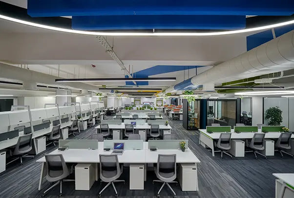
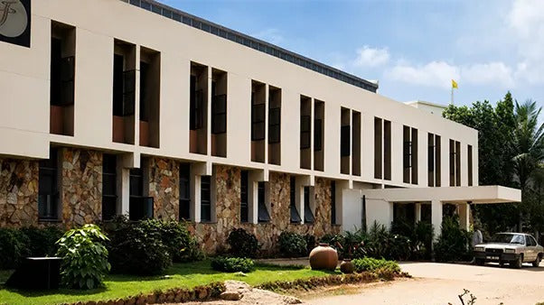
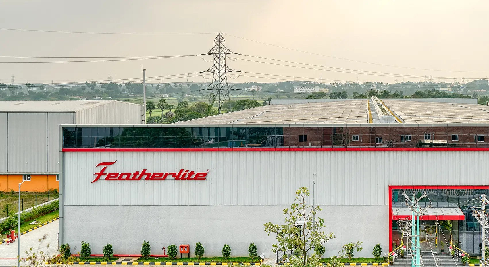
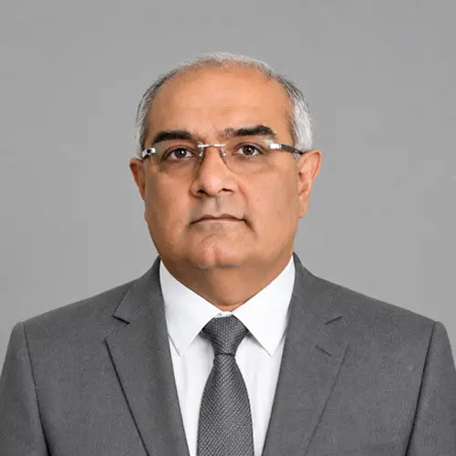
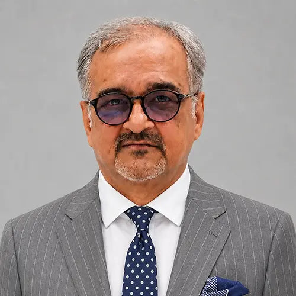
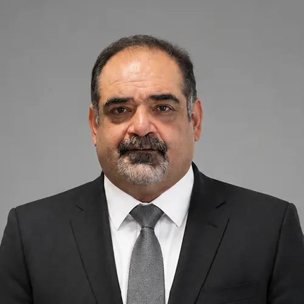
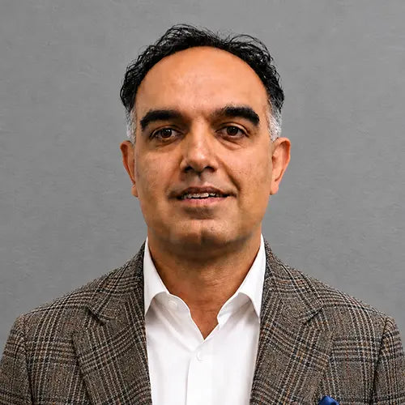
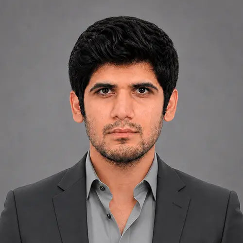

# About Featherlite

Source: https://featherlitestore.com/pages/about

Since 1965

# A 60+ year legacy of leadership, innovation and growth

* **60+** Years of design and manufacturing
* **100,000+** Customers served
* **70** Locations across India
* **650,000** Sq. ft.square foot solar powered factory
* **75,000+** Chairs produced every month
* **25,000+** Workstations produced every month

## About Featherlite

We design how India works, learns, lives and heals.

Since 1965, Featherlite has shaped the spaces where people spend their most important hours. What began with a simple idea (to make furniture lighter, better and more human) has grown into a nationwide movement toward thoughtful, high-performance environments.

Today, we serve over 100,000 customers across 70 locations, powering everything from global capability centres to classrooms, hospitals and homes. Every chair, every workstation, every space is built with one goal in mind: make people feel better, and work better, where they are.

Featherlite factory, 1975

## Our story

Built on insight. Driven by purpose.

Featherlite was founded by Mr. Gopal Ramnarayan with a simple ambition: to create environments that improve the way people work, live, learn and heal.

We pioneered lightweight aluminium furniture in India at a time when the category was virtually non-existent. Since then, we have evolved beyond products to shape spaces that enable productivity, foster collaboration and support wellbeing.

Today, our solutions touch millions of lives every day across workplaces, educational institutions and healthcare facilities, creating environments shaped by purposeful design, built with integrity and driven by continuous improvement.

## Creating spaces that work better for people.

We create spaces engineered for productivity, collaboration and wellbeing. Every solution is shaped by how people work, ensuring environments that are efficient, adaptable and future-ready.

Whether it is a single workspace or a complete workplace transformation, our focus remains the same: delivering spaces that perform.

## What drives us

### Vision

To be India's leading furniture and space solutions brand, creating environments that improve how people work and live.

### Mission

To design ergonomic, purposeful and sustainable solutions that enhance performance, comfort and wellbeing, with the least possible impact on the environment.

### Values

* **Passion.** We care deeply about what we build.
* **Innovation.** We question, test and evolve constantly.
* **Consistency.** Quality is non-negotiable.

## Leadership

* **Jawahar Gopal** Chairman, Featherlite Group
* **Manohar Gopal** Managing Director, Featherlite Group
* **Dhiren Gopal** Director, Featherlite Group
* **Lav Chellaram** Director, Featherlite Group
* **Arune Chellaram** Director, Featherlite Group
* **Kiran Chellaram** Associate Director, Featherlite Group

## Our manufacturing excellence

## Bring Featherlite to your workspace

Shop the range online, or talk to us about furnishing a whole office.

[Shop office chairs](/collections/office-chairs)[Bulk and corporate orders](/pages/corporate-orders)
