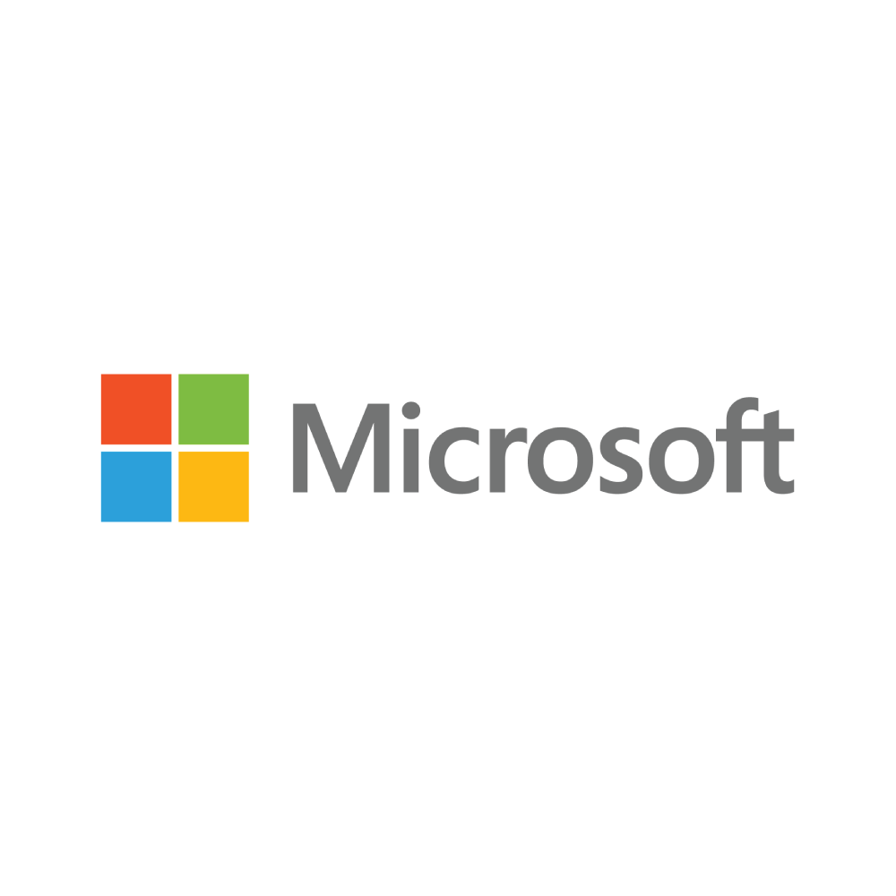
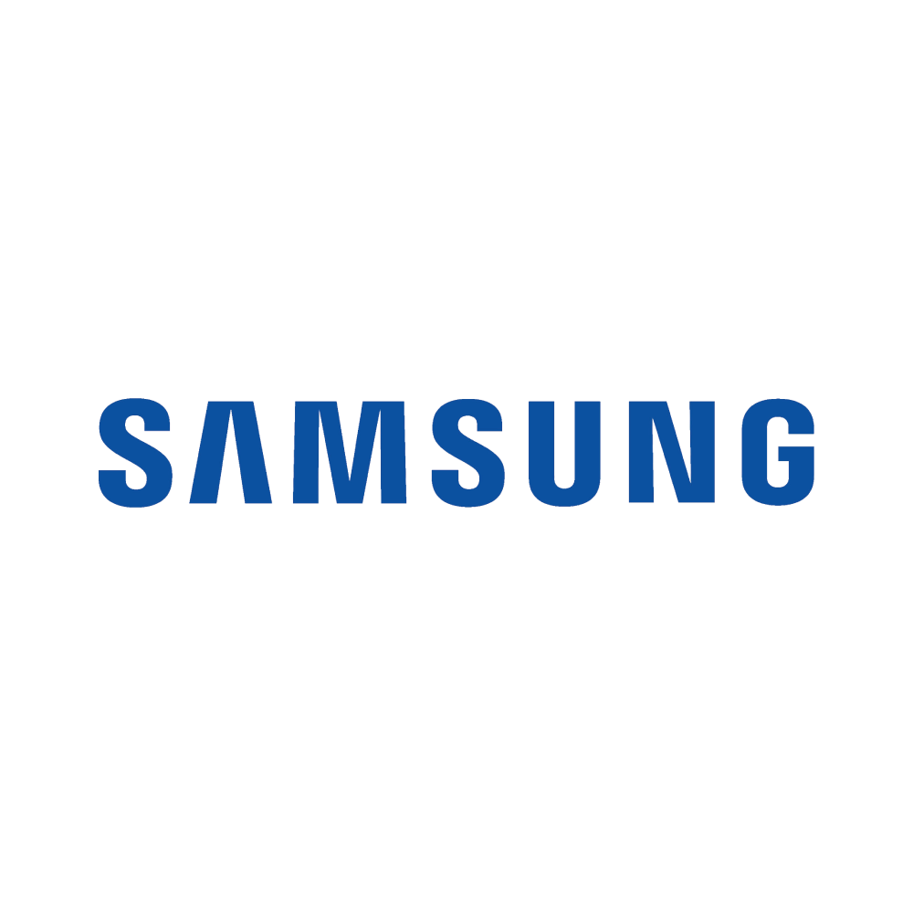
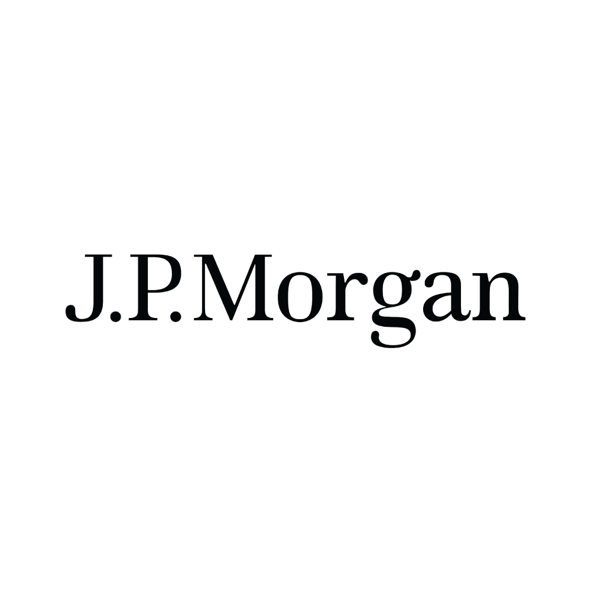
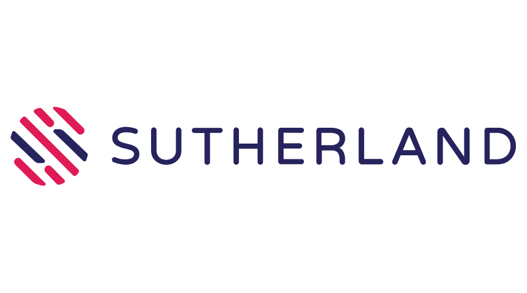

# Customers

Source: https://featherlitestore.com/pages/customers

On the desks of 50,000+ engineers at India's top IT employers.

**50K+**Engineers seated

**200K+**Corporate chairs shipped

**60+**Years of design and manufacturing

**70**Locations across India

## Featherlite chairs are in offices at

Other corporate customers include Cisco, HCL Technologies, Wipro, Tech Mahindra, and 50+ more. Specific corporate references available on request.

## What facilities managers tell us

### What we hear most

"The mechanism survives. We've replaced upholstery on chairs eight years old where the multilock still works perfectly." Feedback we get most often from corporate facilities teams.

## How we work with corporate customers

* **Bulk pricing** on orders of 10+ chairs or full office fit-outs
* **Pan-India delivery** from our Bangalore facility, with regional warehousing in Mumbai, Delhi, Chennai, Hyderabad
* **On-site assembly + warranty service** via our network of 70 locations across India
* **Custom configurations**: fabric choice, branding, embroidery, mechanism specification
* **Trade-in program**: credit on your old office chairs against new ones

## Become a customer

[Request a corporate quote →](/pages/corporate-orders)
