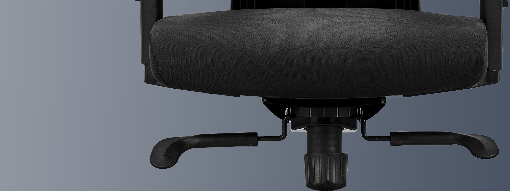

# The Dynaflex System

Source: https://featherlitestore.com/pages/dynaflex-system

Two frames. One spine. Independent flex.

Fig. 1: Dynaflex dual-frame back, Liberate series

## The problem with one-piece backs

Most office-chair backs are a single rigid frame. When you lean, the whole back tilts as one piece. Your lumbar gets supported when you're upright; it loses contact when you recline. The chair stops working when you start moving.

## How Dynaflex solves it

The Dynaflex back is built from two independent frames. The outer frame holds the chair's structural shape. The inner frame (where your back actually sits) flexes within it, mounted on a flexible polymer hinge. When you lean, the outer frame moves, but the inner frame stays in contact with your lumbar curve.

|  |  |
| --- | --- |
| Frame configuration | Dual-frame (outer structural, inner flex) |
| Inner frame flex range | ±18° independent of outer |
| Mesh | IS 20D 20-denier yarn |
| Compatible mechanism | Multilock with seat-slide |
| Used in chairs | Liberate (without headrest, with headrest) |
| Warranty | 3 years |

### Why it matters for 8-hour workdays

Lumbar support that disengages when you recline is the leading cause of lower-back discomfort at hour 6 onward. Dynaflex keeps the contact patch with your spine constant across the full recline range.

## The chair that uses it

[Shop Featherlite Liberate with Headrest →](/products/featherlite-liberate-high-back-mesh-chair-with-dynaflex-back-support-to-provide-dual-frame-flexibility-multilock-mechanism)

## Compare to other mechanisms

* [Multilock with seat-slide](/pages/multilock-mechanism): 5-position lock, no independent back flex
* [Single-lock Synchro](/pages/synchro-tilt): coordinated 2:1 seat + back tilt
