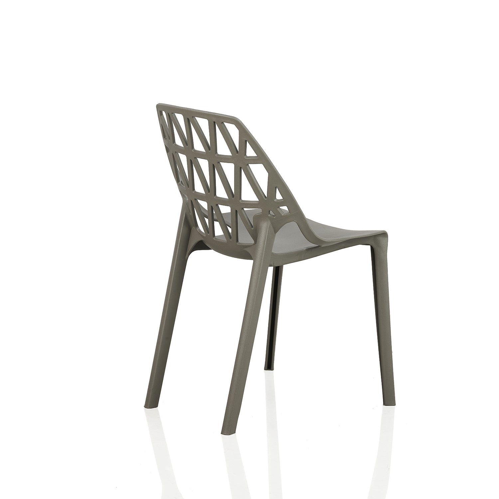
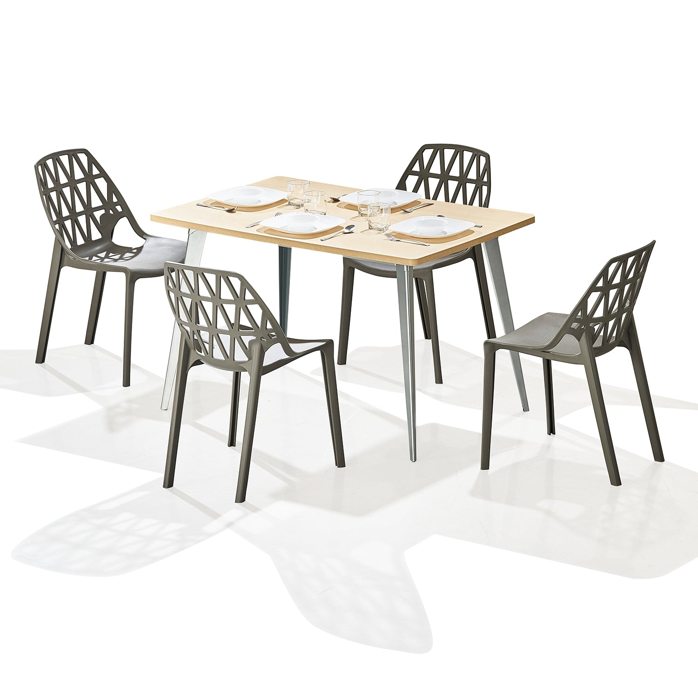

# Engineering

Source: https://featherlitestore.com/pages/engineering

60+ years of designing furniture for the way India actually works.

## The 9-hour problem

The average Indian office worker sits 9 hours a day. We tested every chair in our catalogue against three benchmarks before it shipped: how it holds up at hour 7, how the mechanism survives daily use, and how it fits Indian body sizes. Most office chairs are designed in Europe and validated against a 40-hour week. We designed Featherlite chairs against an Indian 55-hour week.

**60+**Years of design and manufacturing

**250K**Mechanism test cycles

**110 kg**Max user weight

**3 yrs**Mechanism warranty

## How a Featherlite chair is built

### 1. Frame engineering

Frames are stamped from cold-rolled steel, then powder-coated for corrosion resistance. The seat-back hinge, where 90% of chair failures originate, is reinforced with a 3 mm steel sleeve and tested for 250,000 recline cycles before approval.

### 2. Mechanism design

Three mechanism families across the Featherlite range:

* **Multilock with seat-slide**: 5 lockable positions, ±50mm seat depth adjustment. Used in Helix, Optima, Amaze, Anatom, Pinnacle.
* **Dynaflex back support**: dual-frame independent flex. Liberate series flagship.
* **Single-lock Synchro**: coordinated seat + back tilt at 2:1 ratio. Contact, Versa, Astro.

[Read the multilock deep-dive →](/pages/multilock-mechanism)

### 3. Material selection

Mesh grades chosen for India's climate. AN70 (used in Helix, Amaze) is a 70-strand micro-linear mesh tested for shape retention at 38°C ambient over 8-hour load. IS 20D (Liberate, Pinnacle) is a 20-denier yarn rated for higher tensile strength.

[See the materials library →](/pages/materials)

### 4. Bangalore manufacturing

Every Featherlite product is assembled in our Bangalore facility. We don't import frames or mechanisms: both are made on-site. This is what lets us offer a 3-year mechanism warranty: we know exactly which weld, which screw, which mesh weave went into the chair on your desk.

### 5. Quality protocol

Each chair passes a 12-point pre-dispatch inspection: frame welds, mechanism cycle test, mesh tension, castor rotation, gas-lift seal, fabric stitch density, foam compression resilience, armrest range, and four others. We reject roughly 4% of finished units.

## Designed for the workplaces we know

Featherlite chairs are on the desks of 50,000+ engineers at India's largest IT employers. We've shipped over 200,000 chairs to corporate workspaces in the last decade. That feedback loop, direct from facilities managers and the engineers using the chairs, shapes every iteration.

## What we don't do

* We don't rebadge OEM chairs from China.
* We don't use generic gas lifts: every cylinder is BIFMA-tested.
* We don't ship without a 3-year mechanism warranty.
* We don't market chairs as "premium" without showing the spec sheet.

[Shop the range →](/collections/office-chairs)
