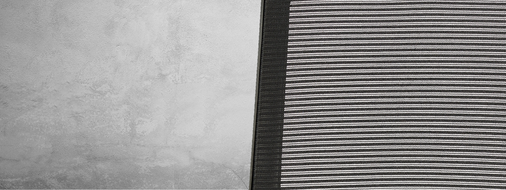
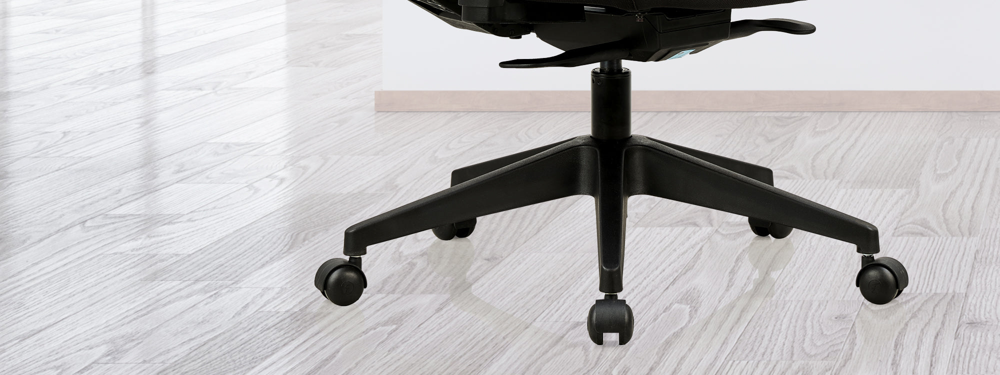
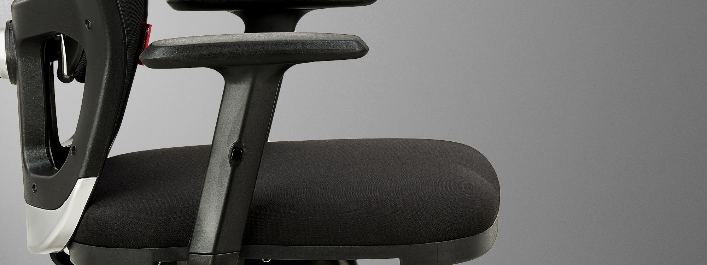

# Materials Library

Source: https://featherlitestore.com/pages/materials

Every mesh weave and fabric grade we use, and which chair uses it.

## Mesh grades

AN70 micro-linear mesh, Amaze series

### AN70 micro-linear mesh

70-strand high-tensile mesh with a tight micro-linear weave. Tested for shape retention at 38°C over 8-hour seated load. Used where structural support matters most.

**Found in:** Helix, Optima, Amaze, Comet

### IS 20D mesh

20-denier yarn with higher elasticity. Better for dual-frame designs where flexibility is the feature.

**Found in:** Liberate (Dynaflex), Pinnacle

## Fabric upholstery

Cushion seats use a fabric upholstered over moulded HR foam. Fabric grade rated for 60,000 Martindale rubs, well above the BIFMA commercial benchmark.

**Used on:** Most cushion-seat variants across all chair lines.

## Leather + Leatherette

Leatherette (PU-coated synthetic) is used on selected executive variants. Genuine leather is available on bespoke corporate orders only: [contact our corporate team](/pages/corporate-orders).

## Frame, base, arms: engineered components

Glass-fibre-reinforced nylon base

4-way adjustable armrest

|  |  |
| --- | --- |
| Frame | Cold-rolled steel, powder-coated |
| Mechanism | Reinforced steel with 3mm sleeve |
| Base (standard) | Glass-fibre-reinforced nylon, 5-prong |
| Base (premium) | Polished aluminium, 5-prong |
| Castors | 60 mm PU-coated, BIFMA-certified |
| Gas lift | Class-4 BIFMA-tested cylinder |

[Browse all office chairs →](/collections/office-chairs)
