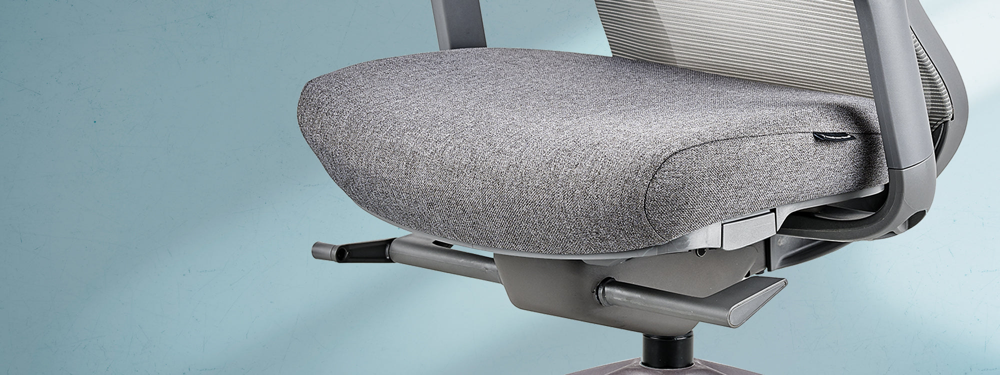
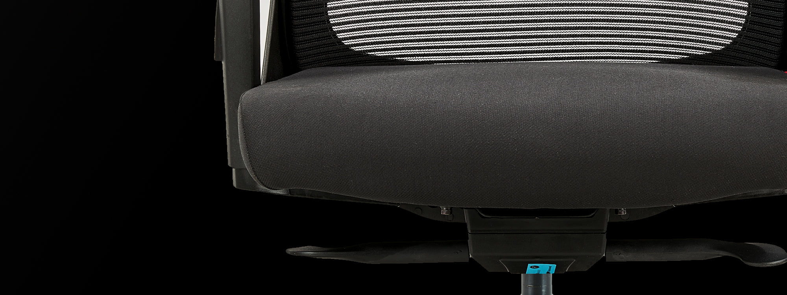
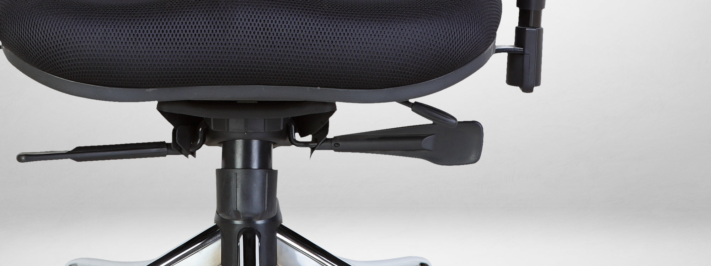
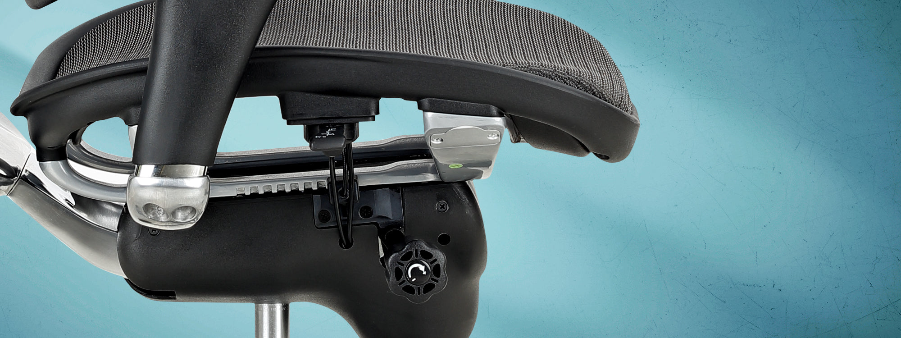
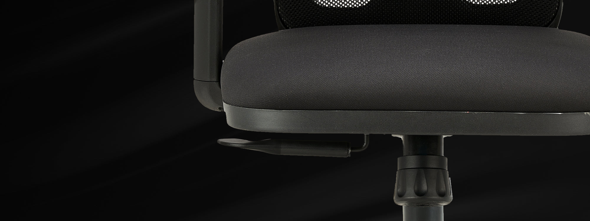

# The Multilock Mechanism

Source: https://featherlitestore.com/pages/multilock-mechanism

The mechanism that anchors most of our flagship chairs.

Fig. 1: Multilock mechanism, Helix with Headrest

## What it does

The multilock mechanism gives the user five lockable back-recline positions and an independent ±50 mm seat-depth slide. Most ergonomic chairs assume your femur length matches the seat depth. It usually doesn't. The multilock lets you adjust both axes independently.

|  |  |
| --- | --- |
| Lockable positions | 5 |
| Back recline range | 14° (upright) to 28° (recline) |
| Seat-depth adjustment | ±50 mm (10 mm increments) |
| Tested cycles | 250,000 lock + unlock cycles |
| Lock engagement force | < 5 N |
| Used in chairs | Helix, Optima, Amaze, Anatom, Pinnacle |
| Warranty | 3 years |

## How it works

1. **Pull right-side handle up**: back unlocks, you can recline freely.
2. **Find the position you want**: there are 5 detent points across the recline range.
3. **Push handle down**: back locks at the current position.
4. **Pull left-side handle**: seat pan slides forward/back independent of the back.
5. **Release**: seat pan locks in 10-mm detent positions.

### Why a 250,000-cycle test matters

At 30 lock/unlock cycles per workday × 250 working days × 5 years, the average user touches the recline handle ~37,500 times. Our 250K target represents 5× that intensity, far beyond the typical 5-year ownership window.

## Chairs using the multilock mechanism

Amaze: Self-calibrating multilock

Optima: Multilock with seat-slide

Pinnacle: Multilock + three-way adjustable arms

Astro: Padded lumbar + multilock

## Other Featherlite mechanisms

* [Dynaflex back support](/pages/dynaflex-system): dual-frame flex, Liberate series
* [Single-lock Synchro](/pages/synchro-tilt): coordinated tilt, Contact / Versa series

[Shop the Optima with Headrest →](/products/featherlite-optima-high-back-mesh-chair-with-multilock-seat-sliding-mechanism-three-way-adjustable-arms) [All multilock chairs →](/collections/chairs-with-headrest)
