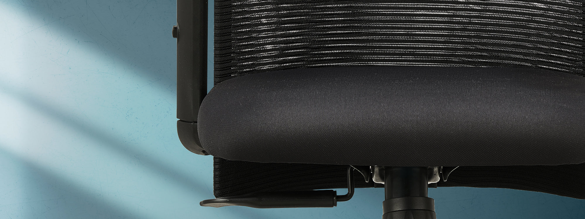
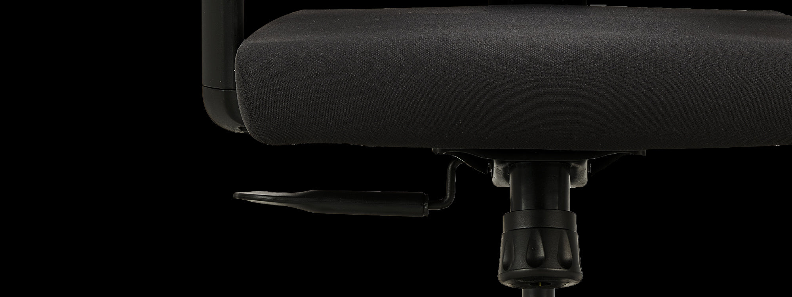
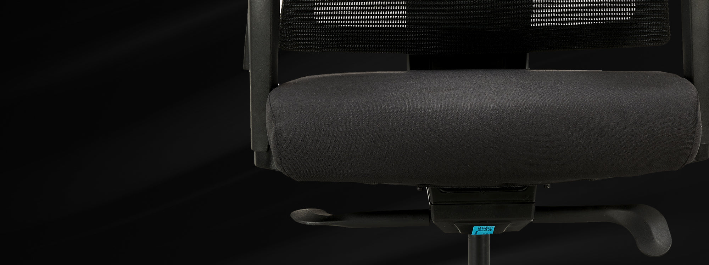

# Single-Lock Synchro Mechanism

Source: https://featherlitestore.com/pages/synchro-tilt

When you recline, your seat tilts back at half the rate. Your feet stay on the floor.

Fig. 1: Single-lock Synchro mechanism, Contact series

## What 2:1 means

A standard tilt mechanism rotates the entire chair around a single pivot point. When you lean back 20°, your feet leave the floor.

A synchro mechanism splits the tilt: the back reclines 20°, but the seat pan only reclines 10°. Your feet stay grounded. Your eye level stays roughly constant. The chair moves with your spine, not against it.

|  |  |
| --- | --- |
| Seat-to-back tilt ratio | 1 : 2 (synchronised) |
| Back recline range | 14° (upright) to 24° (relaxed) |
| Seat tilt range | 7° to 12° |
| Lock positions | 1 (lock or free-tilt) |
| Tilt tension | Adjustable via under-seat knob |
| Used in chairs | Contact, Versa, Astro |

## Synchro variants in the Featherlite range

Versa: Synchro without headrest

Enzo: With headrest variant

## When to use which mechanism

* **Single-lock Synchro**: Best for users who shift between upright and reclined frequently. Encourages active sitting.
* **[Multilock with seat-slide](/pages/multilock-mechanism)**: Best for users who pick a position and stay there for hours. More fine-grained positional control.
* **[Dynaflex](/pages/dynaflex-system)**: Best for users with lumbar pain who need constant contact across recline range.
