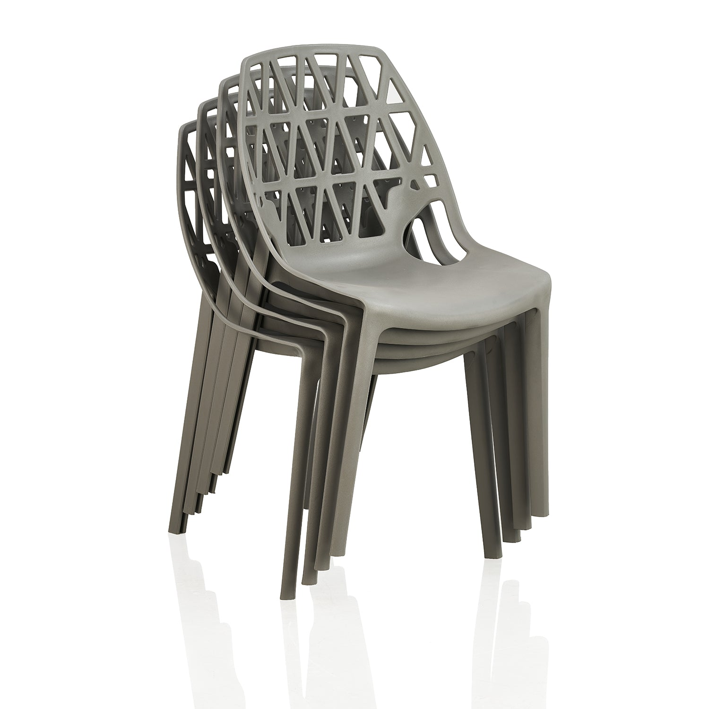
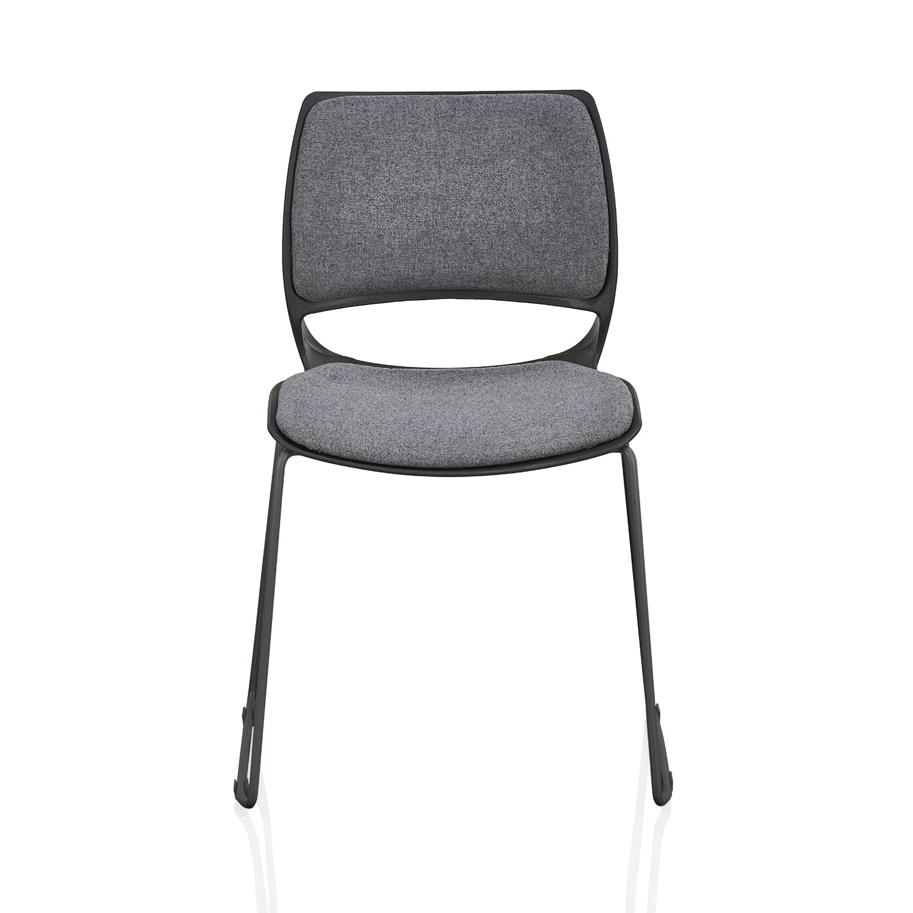

# Workspace Setup Guide

Source: https://featherlitestore.com/pages/workspace-setup-guide

A workstation set up correctly will save you years of physical therapy.

## 1. The chair

Seat height: your knees at ~90°, feet flat on floor. Most adults need seat heights between 42 and 53 cm. If your chair adjusts only between 50 to 58 cm and you're 5'4", that chair was designed for a taller user.

Back support: lumbar pad sits in the small of your back (the inward curve), not lower. Headrest (if any) supports your skull base when reclined, not pressed forward into your neck.

[Shop ergonomic chairs →](/collections/ergonomic-chairs)

## 2. The desk

Desk height: elbows at ~90° when typing. Standard 73-75 cm desks suit users 5'7" to 6'0". Shorter users need a 70-72 cm desk or a footrest; taller users a 76-78 cm desk or a standing-desk converter.

[Shop office tables →](/collections/tables)

## 3. The monitor

Top of the screen at eye level, arm's length away. If you wear progressive lenses, slightly lower (you should be reading through the top half of the lens, not tilting your head back).

## 4. Lighting

Ambient light from the side, not behind the monitor (causes glare on screen) or behind you (causes glare from the screen). 500-750 lux on the work surface for reading documents; lower for screen-only work.

## 5. Accessories

* **Keyboard tray**: wrists straight, not angled up
* **Mouse**: same height as keyboard, immediately adjacent
* **Document holder**: between you and the monitor at the same focal distance
* **Footrest**: only if your feet don't comfortably reach the floor at correct seat height

## 6. Posture habits

Stand and walk for at least 2 minutes every hour. The best ergonomic chair is the one you get out of regularly. Set a timer if you don't naturally take breaks.

**Need a full home-office setup?** [Shop work-from-home chairs →](/collections/wfh-chairs)
